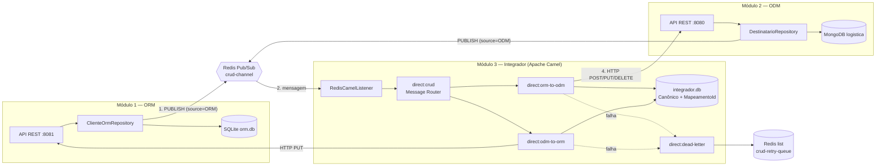
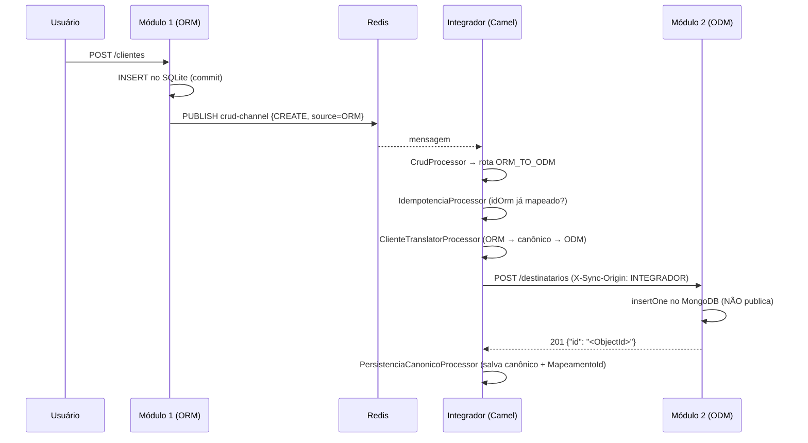
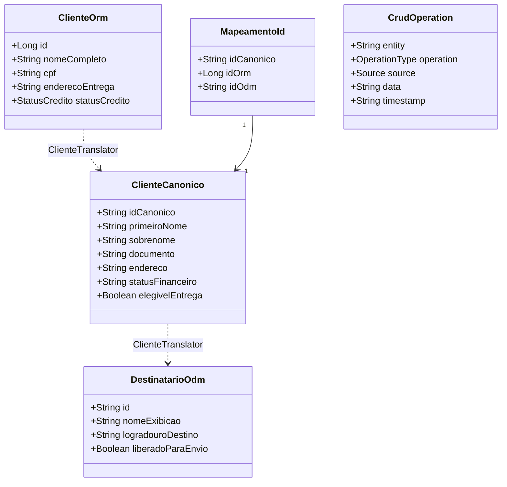

# Integrador de Persistência Poliglota (ORM ↔ ODM) — Kotlin + Apache Camel + Redis

Projeto prático baseado nos tutoriais **Integrador Redis I e II** (Prof. Marcelo Akira, INF/UFG).
Sincroniza a entidade **Cliente** entre dois sistemas com persistências diferentes, usando
um barramento de eventos (Redis Pub/Sub) e um integrador construído com Apache Camel.

| Módulo | Papel | Tecnologia | Porta |
|---|---|---|---|
| `modulo-1-orm` | Persistência A — Vendas/E-Commerce (**ORM**) | Kotlin, Exposed, SQLite, Javalin | 8081 |
| `modulo-2-odm` | Persistência B — Logística/Expedição (**ODM**) | Kotlin, MongoDB driver, Javalin | 8080 |
| `modulo-3-integrador` | **Integrador** (middleware) | Kotlin, Apache Camel, Lettuce, Exposed/SQLite | — |
| `common-events` | Contrato do evento (`CrudOperation`) e `RedisPublisher` compartilhados | Kotlin, Lettuce, Gson | — |

---

## 1. Introdução

Em arquiteturas modernas é comum a mesma informação (aqui, o **cliente**) existir em vários
repositórios com tecnologias distintas: um banco relacional acessado por ORM e um banco de
documentos acessado por ODM. Cada sistema tem seu próprio esquema, seus próprios IDs e seu
próprio vocabulário — para o e-commerce é um *cliente com crédito aprovado*; para a logística,
um *destinatário liberado para envio*.

Replicar dados diretamente entre os bancos acoplaria os dois sistemas. A solução adotada é
**desacoplar via eventos**: cada sistema publica o que fez em um canal Redis, e um integrador
assina esse canal, traduz os dados por meio de um **modelo canônico** e aplica a operação no
outro sistema. Nenhum módulo conhece o esquema do outro.

## 2. Conceitos e Arquitetura

### Padrões de integração (EIPs) aplicados

| Padrão | Onde aparece |
|---|---|
| **Event Message** | `CrudOperation`: envelope JSON `{entity, operation, source, data, timestamp}` |
| **Publish-Subscribe Channel** | Canal Redis `crud-channel`; módulos 1 e 2 publicam, o integrador assina |
| **Event-Driven Consumer** | `RedisCamelListener` (Lettuce) injeta cada mensagem na rota Camel |
| **Message Router** | `CrudProcessor` + `choice()` em `direct:crud` decidem entre `orm-to-odm` e `odm-to-orm` |
| **Message Translator** | `ClienteTranslator` e os processors `ClienteTranslatorProcessor` / `OdmParaOrmProcessor` |
| **Canonical Data Model** | `ClienteCanonico`: formato neutro entre SQLite e MongoDB |
| **Idempotent Receiver** | `IdempotenciaProcessor` + tabela `MapeamentoId`: `CREATE` repetido é descartado |
| **Dead Letter Channel / Retry** | `deadLetterChannel` com 3 reentregas de 2 s; esgotadas, o evento vai para a lista Redis `crud-retry-queue` |

### Diagrama de componentes



### Fluxo ORM → ODM (CREATE)



### Prevenção de loop infinito

O integrador escreve nos módulos 1 e 2 via HTTP com o cabeçalho `X-Sync-Origin: INTEGRADOR`.
Os repositórios dos módulos **não publicam evento** quando recebem esse cabeçalho. Sem isso, um
`UPDATE` no ORM geraria um `UPDATE` no ODM, que republicaria para o ORM, e assim por diante.

### Resiliência

Se o Módulo 2 estiver fora do ar, a rota tenta a requisição **3 vezes com intervalo de 2 s**
(`maximumRedeliveries(3).redeliveryDelay(2000)`). Esgotadas as tentativas, o evento original
é guardado na lista Redis `crud-retry-queue` (Dead Letter). Para reprocessá-la:

```bash
./gradlew :modulo-3-integrador:run --args="--reprocessar"
```

## 3. Modelagem

### Mapeamento semântico

| `ClienteOrm` (SQLite) | `ClienteCanonico` | `DestinatarioOdm` (MongoDB) | Regra |
|---|---|---|---|
| `id: Long` (autoincrement) | `idCanonico: String` (UUID) | `id: String` (ObjectId hex / `_id`) | UUID gerado no integrador; vínculo em `MapeamentoId` |
| `nomeCompleto` | `primeiroNome` + `sobrenome` | `nomeExibicao` | ORM→canônico: separa no 1º espaço. Canônico→ODM: `"$sobrenome, $primeiroNome"` |
| `cpf` | `documento` | *(ausente)* | CPF nunca é enviado ao ODM |
| `enderecoEntrega` | `endereco` | `logradouroDestino` | cópia direta |
| `statusCredito` (`APROVADO`/`BLOQUEADO`) | `statusFinanceiro` + `elegivelEntrega` | `liberadoParaEnvio` | `APROVADO` ⇒ `true` |

### Diagrama de classes



### Envelope de evento

```json
{
  "entity": "Cliente",
  "operation": "CREATE",
  "source": "ORM",
  "data": "{\"id\":1,\"nomeCompleto\":\"Ana Souza\",\"cpf\":\"12345678900\",\"enderecoEntrega\":\"Rua 10, Goiânia\",\"statusCredito\":\"APROVADO\"}",
  "timestamp": "2026-11-25T20:30:00Z"
}
```

### Banco do integrador (`integrador.db`)

| Tabela | Colunas |
|---|---|
| `cliente_canonico` | `id_canonico` (PK), `primeiro_nome`, `sobrenome`, `documento`, `endereco`, `status_financeiro`, `elegivel_entrega` |
| `mapeamento_id` | `id_canonico` (PK), `id_orm` (único), `id_odm` (único) |

### Estrutura do repositório

```text
ecomerce-spd-moises/
├── settings.gradle.kts · build.gradle.kts · docker-compose.yml
├── common-events/          CrudOperation, EventJson, RedisPublisher, logback.xml
├── modulo-1-orm/           ClienteOrm (Exposed), ClienteOrmRepository, OrmServer, OrmApp
├── modulo-2-odm/           DestinatarioOdm + mapper, DestinatarioRepository, OdmServer, OdmServerApp
├── modulo-3-integrador/    model/, translator/, processor/, repository/, redis/, routes/, retry/, IntegradorApp
└── scripts/demo.sh         demonstração ponta a ponta com curl
```

## 4. Compilação e Infraestrutura

Requisitos: **JDK 21** e **Docker**.

```bash
# 1. Infraestrutura (Redis 7 em :6379 e MongoDB 7 em :27017)
docker compose up -d        # (ou docker-compose up -d)

# 2. Compilar tudo e rodar os testes
./gradlew build             # no Windows: gradlew.bat build
```

## Execução

Abra **três terminais** na raiz do projeto. Suba o integrador primeiro (ele precisa estar
assinando o canal antes das publicações — Pub/Sub não guarda mensagens para quem ainda não assinou).

```bash
# Terminal 1 — Integrador
./gradlew :modulo-3-integrador:run

# Terminal 2 — Módulo 2 (ODM / MongoDB)  → http://localhost:8080
./gradlew :modulo-2-odm:run

# Terminal 3 — Módulo 1 (ORM / SQLite)   → http://localhost:8081
./gradlew :modulo-1-orm:run
```

Os arquivos `orm.db` e `integrador.db` são criados dentro da pasta de cada módulo.
Variáveis de ambiente opcionais: `REDIS_URI`, `MONGO_URI`, `ODM_URL`, `ORM_URL`, `ORM_DB`,
`INTEGRADOR_DB`, `ORM_PORT`, `ODM_PORT`.

Para rodar o roteiro completo: `bash scripts/demo.sh`

### API dos módulos

| Módulo 1 (`:8081`) | Módulo 2 (`:8080`) |
|---|---|
| `POST /clientes` | `POST /destinatarios` |
| `PUT /clientes/{id}` (parcial) | `PUT /destinatarios/{id}` (parcial) |
| `DELETE /clientes/{id}` | `DELETE /destinatarios/{id}` |
| `GET /clientes`, `GET /clientes/{id}` | `GET /destinatarios`, `GET /destinatarios/{id}` |

## 5. Testes

| Teste | Módulo | O que valida | Precisa de Redis/Mongo? |
|---|---|---|---|
| `EventJsonTest` | common-events | ida e volta do envelope; JSON inválido devolve `null` | não |
| `ClienteOrmRepositoryTest` | modulo-1-orm | CRUD no SQLite; evento publicado; `publicar=false` não publica | não (publisher falso) |
| `DestinatarioMapperTest` | modulo-2-odm | objeto ↔ documento BSON | não |
| `ClienteTranslatorTest` | modulo-3-integrador | split do nome, `"Sobrenome, Primeiro"`, `APROVADO`→`true`, CPF não vaza, fluxo reverso | não |
| `MapeamentoRepositoryTest` | modulo-3-integrador | grava/busca/remove canônico e mapeamento | não |
| `CrudTransformRouteTest` | modulo-3-integrador | **ponta a ponta da rota Camel** com ODM e ORM falsos (Javalin): CREATE/UPDATE/DELETE, idempotência, fluxo reverso, anti-loop (`X-Sync-Origin`), ODM fora do ar → fila de retry | não |

```bash
./gradlew test                              # todos
./gradlew :modulo-3-integrador:test         # só o integrador
```

O teste **de ponta a ponta real** (com Redis e MongoDB) é o roteiro `scripts/demo.sh`.

## 6. Exemplos de Execução Bem-Sucedida

> ⚠️ **Antes de entregar:** substitua os trechos abaixo por *prints/logs reais* da sua execução.
> Eles mostram o formato esperado, derivado das mensagens de log do código.

**a) Inserção no Módulo 1 (ORM)**

```text
$ curl -X POST localhost:8081/clientes -H 'Content-Type: application/json' \
    -d '{"nomeCompleto":"Ana Souza","cpf":"12345678900","enderecoEntrega":"Rua 10, Goiânia","statusCredito":"APROVADO"}'
{"id":1,"nomeCompleto":"Ana Souza","cpf":"12345678900","enderecoEntrega":"Rua 10, Goiânia","statusCredito":"APROVADO"}
```

**b) Evento trafegando no Redis** (`docker exec -it spd-redis redis-cli SUBSCRIBE crud-channel`)

```text
1) "message"
2) "crud-channel"
3) "{\"entity\":\"Cliente\",\"operation\":\"CREATE\",\"source\":\"ORM\",\"data\":\"{\\\"id\\\":1,...}\",\"timestamp\":\"...\"}"
```

**c) Logs da rota Apache Camel (Terminal 1)**

```text
[REDIS] Mensagem recebida em 'crud-channel': {"entity":"Cliente","operation":"CREATE",...}
[CAMEL] Evento Cliente CREATE origem=ORM -> rota ORM_TO_ODM
[CAMEL] Traduzido ORM -> canônico <uuid> -> ODM DestinatarioOdmPayload(id=null, nomeExibicao=Souza, Ana, ...)
[CAMEL] Persistido canônico <uuid> e mapeamento idOrm=1 <-> idOdm=<ObjectId>
orm-to-odm - Sincronizado ORM -> ODM: POST /destinatarios
```

**d) Registro no MongoDB (Módulo 2)**

```text
$ docker exec spd-mongo mongosh logistica --quiet --eval 'db.destinatarios.find()'
[{ _id: ObjectId('...'), nomeExibicao: 'Souza, Ana', logradouroDestino: 'Rua 10, Goiânia', liberadoParaEnvio: true }]
```

**e) Tabela de mapeamento canônico (`integrador.db`)**

```text
$ sqlite3 modulo-3-integrador/integrador.db "select * from mapeamento_id;"
<uuid>|1|<ObjectId>
```

## 7. Limitações conhecidas

- **Pub/Sub não persiste mensagens.** Se o integrador estiver fora do ar quando o evento é publicado, ele se perde. Evolução natural: **Redis Streams** (com *consumer groups* e ACK) ou o padrão **Transactional Outbox** no módulo de origem.
- **Falha parcial pode duplicar.** Se o `POST` ao ODM der certo mas a gravação do mapeamento falhar, a reentrega criaria um segundo documento. O *outbox* ou uma chave de idempotência enviada ao ODM resolveria.
- **Ordem × vazão.** O consumidor processa em uma thread só para preservar a ordem dos eventos; um evento em retry (até ~6 s) atrasa os seguintes.
- **Fluxo reverso restrito a `UPDATE`** de destinatários que já possuem mapeamento. `CREATE`/`DELETE` originados no ODM são registrados em log e ignorados.
- **Publicação não é atômica com o commit** local: se o Redis estiver fora do ar, a escrita local é mantida e o erro é apenas logado.
